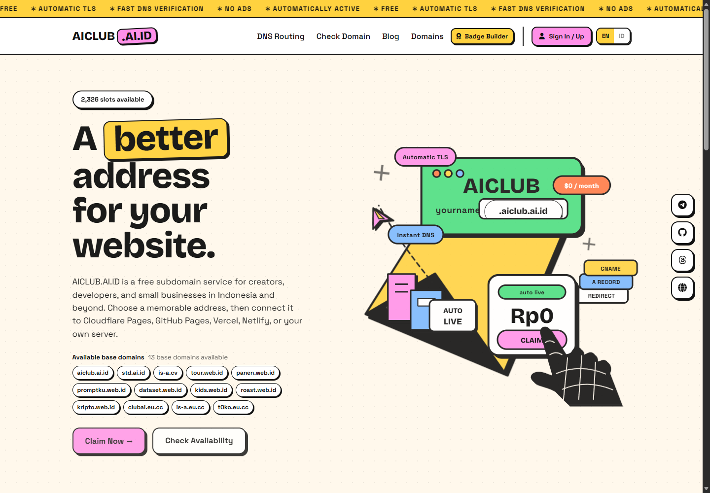
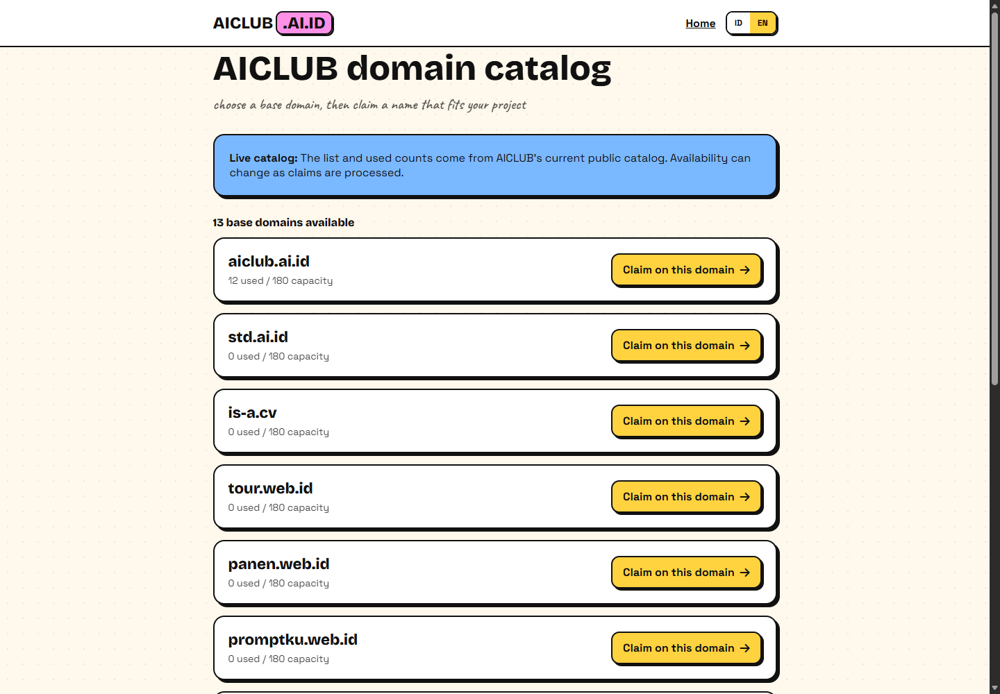
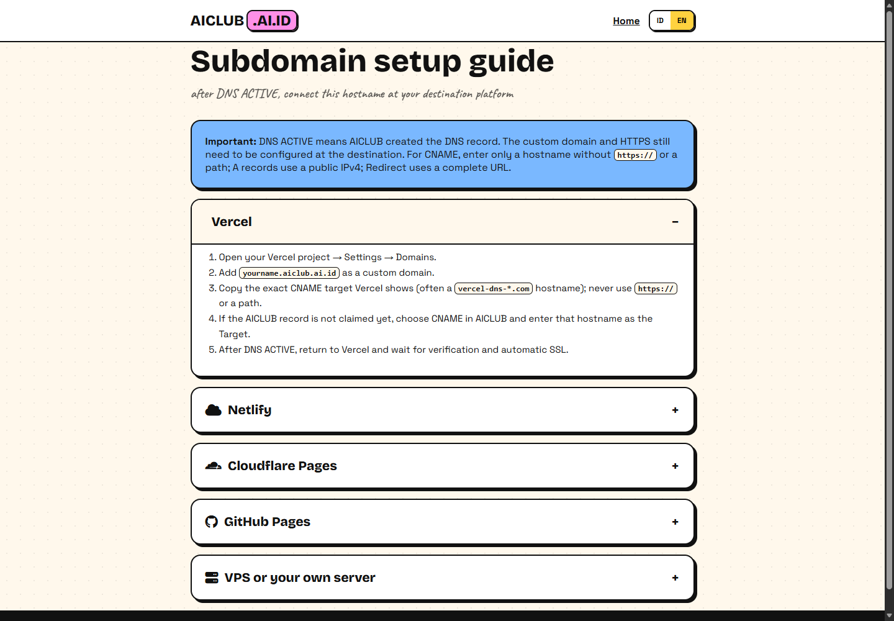

  <h1>AICLUB — Free Subdomains on .AI.ID, .WEB.ID, .CV & More</h1>
  
<strong>Find a memorable free subdomain for your website, portfolio, project, startup, or online community.</strong>

  

    <a href="https://aiclub.ai.id/">Live Website</a>
    &nbsp;·&nbsp;
    <a href="https://aiclub.ai.id/domains/">Live Domain Catalog</a>
    &nbsp;·&nbsp;
    <a href="https://aiclub.ai.id/panduan/setup/">Setup Guide</a>
  

## About AICLUB

AICLUB is a free subdomain service for creators, developers, students, startups, communities, and small businesses. Choose a short and memorable web address, then connect it to your existing destination on **Cloudflare Pages, GitHub Pages, Vercel, Netlify, or your own VPS/server**.

The goal is simple: make a professional-looking website address easier to get, easier to remember, and easier to connect through DNS routing.

AICLUB is useful when you are looking for:

- a free subdomain for a portfolio, landing page, documentation site, or project demo;
- an `.ai.id`, `.web.id`, `.cv`, or `.eu.cc` subdomain;
- a custom subdomain for GitHub Pages, Vercel, Netlify, Cloudflare Pages, or a VPS;
- a free domain-name alternative for personal branding, product launches, and online communities;
- a simple DNS and custom-domain workflow without buying a new domain first.

## Live Domain Catalog

The domains below are live links. Open any one to visit the AICLUB website through that domain and explore the available subdomain workflow.

<table>
  <tr>
    <td width="33%" valign="top"><a href="https://aiclub.ai.id/"><strong>aiclub.ai.id</strong></a> AI projects, SaaS, developer tools  <a href="https://aiclub.ai.id/">Open website</a></td>
    <td width="33%" valign="top"><a href="https://std.ai.id/"><strong>std.ai.id</strong></a> Student projects and experiments  <a href="https://std.ai.id/">Open website</a></td>
    <td width="33%" valign="top"><a href="https://is-a.cv/"><strong>is-a.cv</strong></a> Resumes, portfolios, personal branding  <a href="https://is-a.cv/">Open website</a></td>
  </tr>
  <tr>
    <td valign="top"><a href="https://tour.web.id/"><strong>tour.web.id</strong></a> Travel guides and local destinations  <a href="https://tour.web.id/">Open website</a></td>
    <td valign="top"><a href="https://panen.web.id/"><strong>panen.web.id</strong></a> Agriculture, food, farming, local products  <a href="https://panen.web.id/">Open website</a></td>
    <td valign="top"><a href="https://promptku.web.id/"><strong>promptku.web.id</strong></a> AI prompts, automation, creator tools  <a href="https://promptku.web.id/">Open website</a></td>
  </tr>
  <tr>
    <td valign="top"><a href="https://dataset.web.id/"><strong>dataset.web.id</strong></a> Data projects, research, analytics  <a href="https://dataset.web.id/">Open website</a></td>
    <td valign="top"><a href="https://kids.web.id/"><strong>kids.web.id</strong></a> Educational and family-friendly projects  <a href="https://kids.web.id/">Open website</a></td>
    <td valign="top"><a href="https://roast.web.id/"><strong>roast.web.id</strong></a> Reviews, communities, commentary  <a href="https://roast.web.id/">Open website</a></td>
  </tr>
  <tr>
    <td valign="top"><a href="https://kripto.web.id/"><strong>kripto.web.id</strong></a> Crypto, blockchain, and Web3 projects  <a href="https://kripto.web.id/">Open website</a></td>
    <td valign="top"><a href="https://clubai.eu.cc/"><strong>clubai.eu.cc</strong></a> AI communities and international projects  <a href="https://clubai.eu.cc/">Open website</a></td>
    <td valign="top"><a href="https://is-a.eu.cc/"><strong>is-a.eu.cc</strong></a> Developer identities and open-source profiles  <a href="https://is-a.eu.cc/">Open website</a></td>
  </tr>
  <tr>
    <td valign="top"><a href="https://t0ko.eu.cc/"><strong>t0ko.eu.cc</strong></a> Online shops, product pages, catalogs  <a href="https://t0ko.eu.cc/">Open website</a></td>
  </tr>
</table>

**13 live base-domain options are listed above.** Availability can change, so use the live catalog before claiming a name.

## Website Preview

<table>
  <tr>
    <td width="33%" valign="top">
      
      
<strong>Homepage</strong> Free subdomains, domain chips, and quick claim actions.

    </td>
    <td width="33%" valign="top">
      
      
<strong>Domain Catalog</strong> Browse current `.ai.id`, `.web.id`, `.cv`, and `.eu.cc` options.

    </td>
    <td width="33%" valign="top">
      
      
<strong>Setup Guide</strong> Connect a claimed hostname to your hosting platform.

    </td>
  </tr>
</table>

## How It Works

1. **Choose a base domain** from the live catalog.
2. **Claim a memorable subdomain** for your project or profile.
3. **Configure DNS at your destination platform** using the target hostname.
4. **Publish your website** on a professional-looking custom address.

AICLUB does not replace your hosting provider. It gives you the hostname and DNS workflow, while your website remains hosted on the platform you choose.

## Bahasa Indonesia

AICLUB adalah layanan **subdomain gratis** untuk kreator, developer, pelajar, startup, komunitas, dan bisnis kecil. Pilih alamat website yang singkat dan mudah diingat, lalu hubungkan ke Cloudflare Pages, GitHub Pages, Vercel, Netlify, atau server VPS sendiri.

Pilihan domain yang tersedia mencakup `.ai.id`, `.web.id`, `.cv`, dan `.eu.cc`. Gunakan katalog live untuk mencari nama subdomain gratis yang cocok untuk portofolio, landing page, toko online, dokumentasi, proyek AI, komunitas, atau personal branding.

### Cara menggunakan AICLUB

1. Buka katalog domain dan pilih domain dasar.
2. Klaim nama subdomain yang tersedia.
3. Masukkan target DNS dari platform hosting Anda.
4. Hubungkan dan publikasikan website dengan alamat baru.

## SEO-Friendly Domain Discovery

AICLUB helps people discover practical free subdomain options for searches such as **free subdomain**, **free domain name alternative**, **.ai.id subdomain**, **.web.id subdomain**, **custom domain for GitHub Pages**, **Vercel custom subdomain**, **Netlify custom domain**, **Cloudflare Pages domain**, and **DNS routing for a personal website**.

The domain catalog is designed to grow, so new base domains can appear in the live website without changing this showcase repository.

## Links

- Website: https://aiclub.ai.id/
- Domain catalog: https://aiclub.ai.id/domains/
- Setup guide: https://aiclub.ai.id/panduan/setup/
- Claim flow: https://aiclub.ai.id/masuk

<strong>Choose a better address for your website.</strong>

